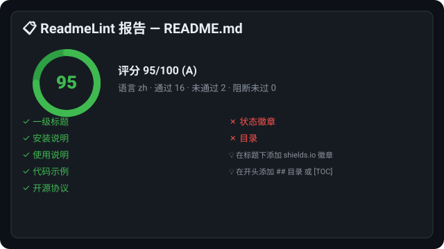

# ReadmeLint

<p align="center">
  
  
  
  
  
</p>

> 📏 零依赖的 README 质量评分与检测工具：用一把统一的尺子衡量开源文档的完整度，让“有代码无文档”无处遁形。
>
> A zero-dependency README quality linter & scorer that grades open-source documentation against best practices — no third-party packages required.

**🌐 语言 / Language：** [简体中文](#简体中文) · [繁體中文](#繁體中文) · [English](#english)

---

## 目录 / Contents

- [简体中文](#简体中文)
- [繁體中文](#繁體中文)
- [English](#english)

---

## 简体中文

### 🎉 项目介绍

**ReadmeLint** 是一款**零依赖**的 README 质量评分与检测工具。它仅使用 Python 标准库，即可解析 Markdown、依据开源文档最佳实践对 README 进行评分，并给出可执行的优化建议。

- **项目定位**：轻量级文档质量门禁（Quality Gate），可单机运行，也可无缝接入 CI 流水线。
- **核心价值**：用统一、可量化的标准衡量开源项目的文档完整度，避免“有代码无文档”或“文档残次”。
- **解决的痛点**：人工检查 README 费时且标准不一；本工具把社区最佳实践沉淀为可复用、可解释的规则。
- **自研差异化亮点**：纯标准库实现、零第三方依赖、规则权重可配置、中英双语检测、支持批量扫描仓库集合。
- **灵感来源**：受“文档即门面”的开源理念启发，结合对海量仓库 README 的体感沉淀而成。

### ✨ 核心特性

- 🚀 **零依赖**：仅依赖 Python 标准库，安装即用，无环境依赖陷阱与供应链风险。
- 📊 **加权评分**：18 条规则按严重程度（阻断 / 警告 / 提示）与权重计算 0–100 分与等级 A–F。
- 🌐 **双语检测**：自动识别中文 / 英文 README，规则关键字中英双覆盖。
- 🛠️ **可配置规则**：通过 JSON 启用 / 停用规则、调整权重、设定最低字数。
- 📦 **多种输出**：文本（带颜色）、JSON、Markdown 三种报告格式随心切换。
- 🔁 **批量扫描**：一键审查目录下所有子仓库的 README，输出汇总表。
- ⚙️ **CI 门禁**：`--min-score` / `--strict` 让低质量文档在流水线中直接失败。
- 💡 **可执行建议**：每一条未通过项都附带具体、可落地的改进提示。

### 🚀 快速开始（安装 / Installation）

**环境要求**：Python ≥ 3.9（推荐 3.11）。

```bash
# 安装
pip install readmelint

# 检测单个 README
readmelint lint README.md

# 检测并生成 JSON 报告
readmelint lint README.md --format json --report report.json
```

### 📖 详细使用指南

**检测目录**：传入目录时，会自动查找其中的 `README*.md` 并逐个检测。

```bash
readmelint lint ./my-project
```

**批量扫描**：传入包含多个仓库子目录的根目录，一键审查整组仓库。

```bash
readmelint batch ./repos --format json --report batch.json
```

**自定义规则**：新建 `rules.json` 调整策略。

#### ⚙️ 配置与自定义规则 / Configuration

通过 `rules.json` 调整策略，例如设定最低字数与规则权重：

```json
{
  "min_words": 200,
  "license": { "enabled": true, "weight": 15 },
  "badges": { "enabled": false }
}
```

```bash
readmelint lint README.md --rules rules.json
```

**CI 集成**（GitHub Actions 片段）：

```yaml
- name: Lint README
  run: pip install readmelint && readmelint lint README.md --min-score 80 --strict
```

### 🖼️ 演示 / Demo



### 💡 设计思路与迭代规划

- **设计理念**：文档质量应当可量化、可自动化、可配置，且标准透明、可解释。
- **技术选型**：纯标准库实现，避免依赖膨胀与供应链攻击面；规则引擎数据驱动，便于扩展。
- **迭代计划**：后续将加入“相对上次提交的文档变更检测”“PDF / HTML 文档支持”“规则市场”。
- **社区贡献方向**：欢迎补充多语言规则、新增输出格式、丰富内置规则集。

### 📦 打包与部署指南

- **作为命令行工具**：`pip install readmelint` 后即可全局调用 `readmelint`。
- **作为库使用**：`from readmelint import parse, apply_rules, score`。
- **本地构建**：`python -m build` 生成 wheel 与 sdist。
- **兼容环境**：Linux / macOS / Windows；Python 3.9 – 3.12。

### 🤝 贡献指南

1. Fork 本仓库并创建特性分支（`feat/your-feature`）。
2. 运行 `make test` 确保全部测试通过。
3. 提交遵循 Angular 提交规范（`feat:` / `fix:` / `docs:` / `refactor:`）。
4. 发起 Pull Request，清晰描述改动与动机。

### 📄 开源协议说明

本项目基于 **MIT 协议** 开源，可自由用于商业与非商业场景，请保留原始版权声明。

### 🔄 更新日志 / Changelog

- **v1.0.0**：首发版本，包含 18 条质量规则、三种输出格式与批量扫描能力。

---

## 繁體中文

### 🎉 專案介紹

**ReadmeLint** 是一款**零依賴**的 README 品質評分與檢測工具。它僅使用 Python 標準函式庫，即可解析 Markdown、依據開源文件最佳實踐對 README 進行評分，並給出可執行的優化建議。

- **專案定位**：輕量級文件品質門禁（Quality Gate），可單機執行，也能無縫接入 CI 流程。
- **核心價值**：用統一、可量化的標準衡量開源專案的文件完整度，避免「有程式碼無文件」或「文件殘次」。
- **解決的痛點**：人工檢查 README 費時且標準不一；本工具把社群最佳實踐沉澱為可復用、可解釋的規則。
- **自研差異化亮點**：純標準函式庫實作、零第三方依賴、規則權重可配置、中英雙語檢測、支援批次掃描倉庫集合。
- **靈感來源**：受「文件即門面」的開源理念啟發，結合對海量倉庫 README 的體感沉澱而成。

### ✨ 核心特性

- 🚀 **零依賴**：僅依賴 Python 標準函式庫，安裝即用，無環境依賴陷阱與供應鏈風險。
- 📊 **加權評分**：18 條規則依嚴重程度（阻斷 / 警告 / 提示）與權重計算 0–100 分與等級 A–F。
- 🌐 **雙語檢測**：自動辨識中文 / 英文 README，規則關鍵字中英雙覆蓋。
- 🛠️ **可配置規則**：透過 JSON 啟用 / 停用規則、調整權重、設定最低字數。
- 📦 **多種輸出**：文字（帶顏色）、JSON、Markdown 三種報告格式隨心切換。
- 🔁 **批次掃描**：一鍵審查目錄下所有子倉庫的 README，輸出彙總表。
- ⚙️ **CI 門禁**：`--min-score` / `--strict` 讓低品質文件在流程中直接失敗。
- 💡 **可執行建議**：每一條未通過項都附帶具體、可落地的改進提示。

### 🚀 快速開始（安裝 / Installation）

**環境要求**：Python ≥ 3.9（推薦 3.11）。

```bash
# 安裝
pip install readmelint

# 檢測單一 README
readmelint lint README.md

# 檢測並產生 JSON 報告
readmelint lint README.md --format json --report report.json
```

### 📖 詳細使用指南

**檢測目錄**：傳入目錄時，會自動尋找其中的 `README*.md` 並逐一檢測。

```bash
readmelint lint ./my-project
```

**批次掃描**：傳入包含多個倉庫子目錄的根目錄，一鍵審查整組倉庫。

```bash
readmelint batch ./repos --format json --report batch.json
```

**自定義規則**：新建 `rules.json` 調整策略。

#### ⚙️ 配置 / Configuration

透過 `rules.json` 調整策略，例如設定最低字數與規則權重：

```json
{
  "min_words": 200,
  "license": { "enabled": true, "weight": 15 },
  "badges": { "enabled": false }
}
```

```bash
readmelint lint README.md --rules rules.json
```

**CI 整合**（GitHub Actions 片段）：

```yaml
- name: Lint README
  run: pip install readmelint && readmelint lint README.md --min-score 80 --strict
```

### 🖼️ 示範 / Demo


### 💡 設計思路與迭代規劃

- **設計理念**：文件品質應當可量化、可自動化、可配置，且標準透明、可解釋。
- **技術選型**：純標準函式庫實作，避免依賴膨脹與供應鏈攻擊面；規則引擎資料驅動，便於擴充。
- **迭代計畫**：後續將加入「相對上次提交的文档變更檢測」「PDF / HTML 文件支援」「規則市集」。
- **社群貢獻方向**：歡迎補充多語言規則、新增輸出格式、豐富內建規則集。

### 📦 打包與部署指南

- **作為命令列工具**：`pip install readmelint` 後即可全域呼叫 `readmelint`。
- **作為函式庫使用**：`from readmelint import parse, apply_rules, score`。
- **本地構建**：`python -m build` 產生 wheel 與 sdist。
- **相容環境**：Linux / macOS / Windows；Python 3.9 – 3.12。

### 🤝 貢獻指南

1. Fork 本倉庫並建立特性分支（`feat/your-feature`）。
2. 執行 `make test` 確保全部測試通過。
3. 提交遵循 Angular 提交規範（`feat:` / `fix:` / `docs:` / `refactor:`）。
4. 發起 Pull Request，清楚描述改動與動機。

### 📄 開源協議說明

本專案基於 **MIT 協議** 開源，可自由用於商業與非商業場景，請保留原始版權聲明。

### 🔄 更新日誌 / Changelog

- **v1.0.0**：首發版本，包含 18 條品質規則、三種輸出格式與批次掃描能力。

---

## English

### 🎉 Introduction

**ReadmeLint** is a **zero-dependency** README quality linter and scorer. Using only the Python standard library, it parses Markdown, scores a README against open-source documentation best practices, and emits actionable improvement suggestions.

- **Positioning**: a lightweight documentation Quality Gate that runs locally or plugs straight into your CI pipeline.
- **Core value**: measure the completeness of open-source docs with one unified, quantifiable standard — no more "code without docs" or half-baked READMEs.
- **Problem solved**: manual README review is slow and inconsistent; ReadmeLint distills community best practices into reusable, explainable rules.
- **Differentiators**: pure-stdlib implementation, zero third-party dependencies, configurable rule weights, zh/en detection, and batch scanning of repo collections.
- **Inspiration**: born from the "docs are the front door" philosophy of open source, refined by hands-on experience across thousands of repositories.

### ✨ Core Features

- 🚀 **Zero dependencies**: standard library only — install and run, with no dependency traps or supply-chain surface.
- 📊 **Weighted scoring**: 18 rules weighted by severity (blocker / warning / info) produce a 0–100 score and an A–F grade.
- 🌐 **Bilingual detection**: automatically detects Chinese / English READMEs with bilingual rule keywords.
- 🛠️ **Configurable rules**: enable / disable rules, tune weights, and set a minimum word count via JSON.
- 📦 **Multiple outputs**: human-readable (colored), JSON, and Markdown report formats.
- 🔁 **Batch scanning**: lint every sub-repo's README under a directory and get a summary table.
- ⚙️ **CI gate**: `--min-score` / `--strict` fail the pipeline on low-quality docs.
- 💡 **Actionable advice**: every failed check ships with a concrete, copy-pasteable fix.

### 🚀 Quick Start & Installation

**Requirements**: Python ≥ 3.9 (3.11 recommended).

```bash
# Install
pip install readmelint

# Lint a single README
readmelint lint README.md

# Lint and emit a JSON report
readmelint lint README.md --format json --report report.json
```

### 📖 Usage Guide

**Lint a directory**: when given a directory, ReadmeLint finds every `README*.md` inside and lints them.

```bash
readmelint lint ./my-project
```

**Batch scan**: point it at a root directory of many repos to review the whole collection at once.

```bash
readmelint batch ./repos --format json --report batch.json
```

**Custom rules**: create a `rules.json` to tune the policy.

#### ⚙️ Configuration

Tune the policy with `rules.json`, for example setting the minimum word count and rule weights:

```json
{
  "min_words": 200,
  "license": { "enabled": true, "weight": 15 },
  "badges": { "enabled": false }
}
```

```bash
readmelint lint README.md --rules rules.json
```

**CI integration** (GitHub Actions snippet):

```yaml
- name: Lint README
  run: pip install readmelint && readmelint lint README.md --min-score 80 --strict
```

### 🖼️ Demo


### 💡 Design & Roadmap

- **Design philosophy**: documentation quality should be quantifiable, automatable, and configurable, with transparent and explainable standards.
- **Tech choices**: pure standard library to avoid dependency bloat and supply-chain attack surface; a data-driven rule engine for easy extension.
- **Roadmap**: diff-based doc-change detection since the last commit, PDF / HTML document support, and a community rule marketplace.
- **Contribution ideas**: add more multilingual rules, new output formats, or enrich the built-in rule set.

### 📦 Packaging & Deployment

- **As a CLI**: `pip install readmelint` exposes the global `readmelint` command.
- **As a library**: `from readmelint import parse, apply_rules, score`.
- **Build locally**: `python -m build` produces a wheel and an sdist.
- **Compatibility**: Linux / macOS / Windows; Python 3.9 – 3.12.

### 🤝 Contributing

1. Fork the repo and create a feature branch (`feat/your-feature`).
2. Run `make test` and make sure all tests pass.
3. Follow the Angular commit convention (`feat:` / `fix:` / `docs:` / `refactor:`).
4. Open a Pull Request describing the change and its motivation.

### 📄 License

Released under the **MIT License** — free for commercial and non-commercial use; please retain the copyright notice.

### 🔄 Changelog

- **v1.0.0**: initial release with 18 quality rules, three output formats, and batch scanning.

---

<p align="center">Made with ❤️ by gitstq · MIT License</p>
